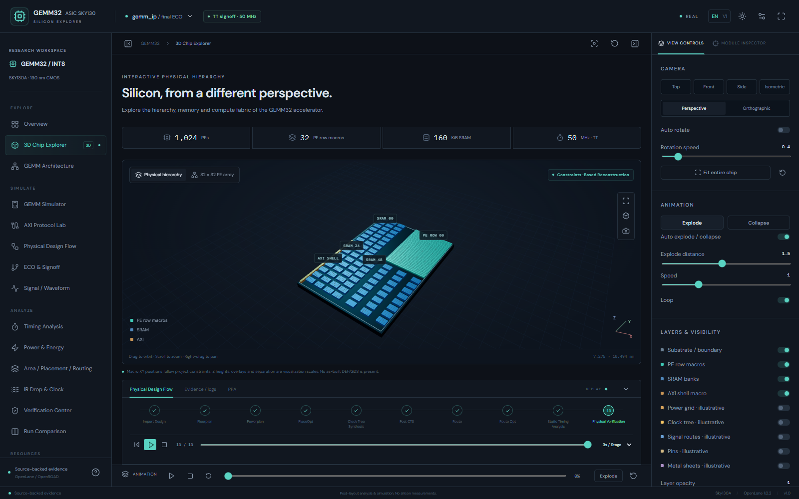

# GEMM32 · Silicon Explorer

An interactive bilingual research viewer for the **actual GEMM32 INT8 Sky130A project**. The website is isolated in `chip-visualizer/`; the research RTL, testbenches, constraints and results are read-only inputs.

The default scene reconstructs the **full integrated IP**, with 32 PE-row macros, 80 SRAM macros and one AXI shell. **This is a constraints-based reconstruction, not an as-built DEF/GDS.** Analytics prioritize the final ECO IP at **50 MHz TT library signoff**, with explicit SRAM, SS and I/O exceptions. No measurements on silicon are claimed.

## Run on a laptop / Chạy trên laptop

Use Node **22.12+** (tested with 24.22.1). From this folder:

```sh
npm install
npm run dev
```

Open the localhost address printed by Vite (normally `http://127.0.0.1:5173`). No EDA installation or backend is required. For reproducible dependency installation, use the included pnpm lockfile:

```sh
pnpm install --frozen-lockfile
pnpm dev
```

PowerShell can run these commands after `cd` into this folder, including paths with spaces or Vietnamese characters. This session's bundled runtime provides pnpm even though npm is not on the host PATH; ordinary Node installations include npm. The test commands below were run with pnpm.

On this Codex laptop, if `npm`/`pnpm` is not found on PATH, run from this folder:

```powershell
$gemmPnpm = Join-Path $env:USERPROFILE '.cache\codex-runtimes\codex-primary-runtime\dependencies\bin\fallback\pnpm.cmd'
& $gemmPnpm dev
```

## Features

- Real WebGL 3D macro explorer; orbit, zoom, pan, smooth presets, perspective/orthographic cameras, selection, search, focus and isolation.
- Independent rotation and explosion; play/pause/stop/replay, timeline seeking, loop/speed/distance, labels, opacity, clipping, wireframe and screenshot export.
- Separate **conceptual** 1,024-PE architecture scene and RTL block/port explorer.
- English / Vietnamese without reload; persisted language and theme; collapsible and resizable panels, focus mode, fullscreen and keyboard shortcuts.
- Editable 4×4 signed INT8 mathematical GEMM demonstration, per-MAC stepping, software reference, RTL-derived round-half-up/saturation and IP v1 host validator.
- AXI protocol demonstration: three 256-bit streams, stable stalled payload/sidebands, deterministic stalls, handshake trace, AW/W/B/AR/R demo and RTL-sourced register semantics including strobes, W1C and registered IRQ.
- Ten-stage source-mapped physical-design replay; antenna ECO replay, metrics, CSV export and links to inspect copied evidence.
- Sparse real RTL debug trace viewer; normalized digital VCD import, radix selection and cursor/zoom/playback.
- Source-backed power/energy, timing histograms, area/routing, original IR-drop figures and sample nodes, clock slew, verification and implementation comparisons.

See [IMPLEMENTATION_STATUS.md](IMPLEMENTATION_STATUS.md) for exact COMPLETE / PARTIAL / NOT IMPLEMENTED classifications. A working demo is not an RTL proof or a transistor-level digital twin.



The complete created/modified file list is in [FILE_MANIFEST.md](FILE_MANIFEST.md). The Data / Documentation page also opens the six website guides. If you edit those guides, run `python scripts/extraction/export_docs.py` before rebuilding their static copies.

## Controls

Drag to orbit; wheel to zoom; right-drag to pan. Select a macro to inspect its hierarchy and source. Inspector search accepts names or instance paths. Presets and Fit frame the chip; Focus frames the selected macro. Right-side settings survive closing/reopening the panel.

- `F`: toggle focus mode; `Esc`: exit focus.
- `R`: reset camera.
- `Space`: play/pause 3D explosion while a 3D page is active.
- Rotation is independent of explosion playback. Pause stops explosion at the current position; turn Auto rotate off to freeze the camera too.
- Bottom stage playback is separate from the 3D animation timeline. Neither runs tools.

EN/VI nằm trên thanh trên cùng. Chuyển ngôn ngữ giữ nguyên mô phỏng. Giao diện không sửa RTL và không điều khiển chip thật. Các đoạn trích nguồn giữ nguyên ngôn ngữ gốc.

## Quality checks

```sh
npm run typecheck
npm run lint
npm test
npm run test:parsers
python scripts/validation/check_translations.py
npm run build
npm run test:e2e
```

Browser tests use installed Google Chrome locally and Playwright Chromium when `CI=1`, headless, with software WebGL for reproducibility. Install Chromium for CI:

```sh
npx playwright install chromium
```

Screenshots and browser reports go into ignored `test-results/` and `playwright-report/`. `scripts/validation/source-baseline.json` records SHA-256 for every original source file; parser tests verify they remain unchanged. No full ASIC flow is run.

## Data and future integration

The checked-in `public/generated-data/project.json` lets this folder run independently of the research workspace. Regeneration needs the original project. See [DATA_INTEGRATION_GUIDE.md](DATA_INTEGRATION_GUIDE.md), [DATA_AVAILABILITY.md](DATA_AVAILABILITY.md), [DATA_SOURCES.md](DATA_SOURCES.md) and [LIMITATIONS.md](LIMITATIONS.md).

Only small JSON/CSV/text and selected project figures are served. No PDK, GDS, Liberty, raw multi-GB netlist or absolute laptop path is shipped to the browser. Self-hosted Fontsource assets keep the app independent of Google Fonts requests; their OFL license notices are in the installed packages.

## Static build and GitHub Pages

```sh
npm run build
npm run preview
```

The production base is `/WEB_GEMM_ASIC_SKY130/gemm32/`. Development still runs at `/`. To preview the default production build, open the full base path. Override `VITE_BASE_PATH` only when deliberately targeting a different host path. Navigation uses hash URLs such as `#/timing`; direct links, refresh, Back and Forward work on a static host without server rewrites. Opening `dist/index.html` through `file://` does not support dataset fetches.

The target repository already has a separate website. Preserve its root `index.html`, `src/`, `public/`, `docs/`, `scripts/` and `package.json`. Add this entire app as root `chip-visualizer/`. The proposed single workflow builds the existing site with its unchanged build command, builds this app separately, then places this app's output in the existing site's generated `dist/gemm32/`. Both sites are uploaded as one Pages artifact. Do not deploy this app's `dist/` alone to the existing Pages site.

Preparation and review files:

- `scripts/deployment/prepare_repository.py`: syncs an inspected local clone under `.tooling/deployment/repository`; refuses independent source changes; performs no Git writes or deployment.
- `deployment/github-pages.yml`: proposed replacement for the existing root `.github/workflows/deploy.yml`. It verifies both sites before a single Pages deployment; pull requests only build and test.
- `scripts/deployment/compose-pages.mjs`: combines generated output, checks every original site asset's hash, rejects raw ASIC binaries/PDK artifacts, large files and credential patterns, and creates a strict static preview tree.
- `deployment/REVIEW.md`: preparation results, changed-file list, local review links, authentication notes and approval boundary.

After explicit approval, use an account with repository write access and workflow permission. Keep Pages source set to GitHub Actions. This app does not grant redistribution rights to the hardware design; the copied research evidence remains attributed to its original sources.

Nothing has been committed, pushed or deployed by this implementation.

## Architecture and compatibility

React 19 pairs with Fiber 9 per [official Fiber installation guidance](https://r3f.docs.pmnd.rs/getting-started/installation). Node requirements follow the [Vite guide](https://vite.dev/guide/). Repeated geometry uses [Three.js InstancedMesh](https://threejs.org/docs/pages/InstancedMesh.html). Exact installed versions are locked in `pnpm-lock.yaml`.

The app separates typed adapters (`src/data-adapters/`), evidence extraction (`scripts/extraction/`), pure GEMM/AXI engines, view settings, bilingual dictionaries, WebGL scenes and analytics. Replacing macro geometry does not replace the simulation state, language, camera controls or dashboard data.
